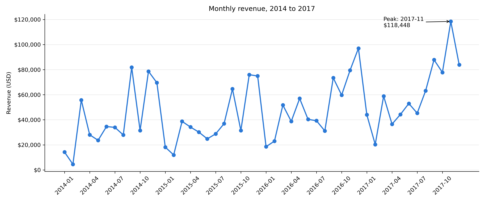
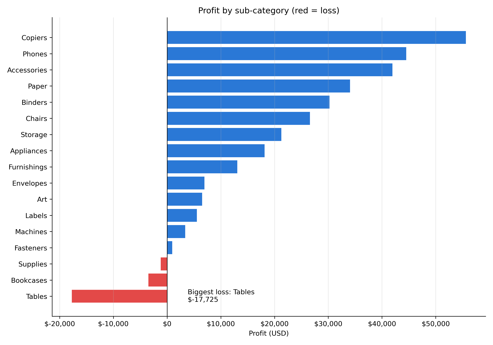
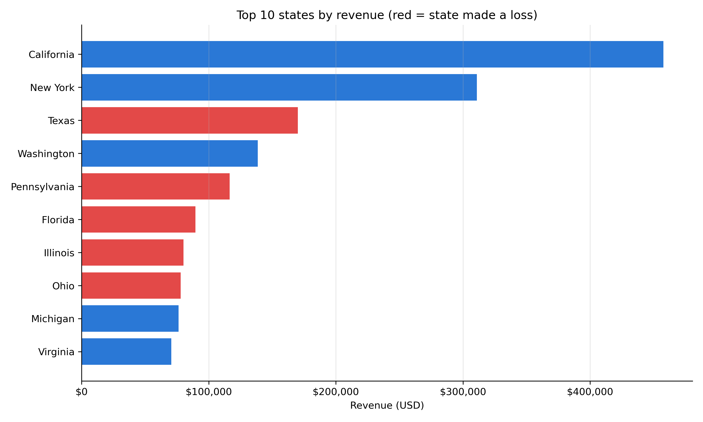
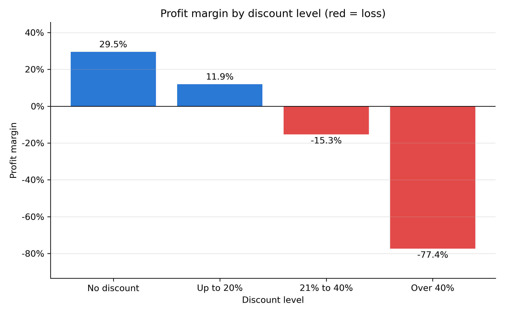

# Sales Data Analysis: Sample Superstore

CodeNova Data Science Internship, Batch 01, Task 1.

I analysed four years of retail sales to find out what drives revenue and profit, and why some sales lose money.

## Executive summary

- **Revenue:** $2,296,919.49 from 5,009 orders and 37,871 units sold
- **Profit:** $286,409.08, a margin of 12.47%
- **Average order value:** $458.56
- **Period:** 3 January 2014 to 30 December 2017

## Key findings

1. **Sales trend:** revenue changed from [2014 revenue] in 2014 to [2017 revenue] in 2017. The strongest months were [months] and the weakest were [months].
2. **Categories:** [category] had the highest revenue, while [category] had the best margin at [margin]%.
3. **Products:** Tables lost $17,725, and Bookcases and Supplies also lost money. [Top sub-category] earned the most profit.
4. **Regions:** [region] had the highest revenue. [Number] states lost money overall.
5. **High sales do not mean high profit:** Texas, Pennsylvania, Florida, Illinois and Ohio are all in the top 10 states by revenue, but all five made a loss.
6. **Discounts:** margin falls from 29.5% with no discount to -15.3% at 21% to 40%, and -77.4% above 40%. The five loss-making states averaged 30% to 39% discounts, compared with 7.3% in California and 5.5% in New York.

## Recommendations

1. **Review discounts above 20%.** Sales at these levels lost money overall, so test lower limits first.
2. **Review pricing for Tables and Bookcases.** Both have high average discounts and lost money.
3. **Investigate Supplies separately.** It lost money with a low average discount of 7.7%, so discounts do not explain it.
4. **Plan for the busy season.** Prepare stock and staff before [strongest months].

## Limitations

High discounts are linked to losses, but this does not prove they caused them. Other costs, such as shipping, could also matter. This is a public practice dataset, so results should not be treated as a real company's results.

## Charts

## Tech stack

Python, Pandas, Matplotlib, Jupyter Notebook

## How to run

1. Install the packages: `pip install pandas matplotlib notebook`
2. Keep `Sample - Superstore.csv` in the same folder as the notebook.
3. Open `sales_analysis.ipynb` and click Run All.

## Files

- `sales_analysis.ipynb`: the full analysis
- `Sample - Superstore.csv`: the dataset
- `charts/`: chart images
#dataset
Sample - Superstore.csv

